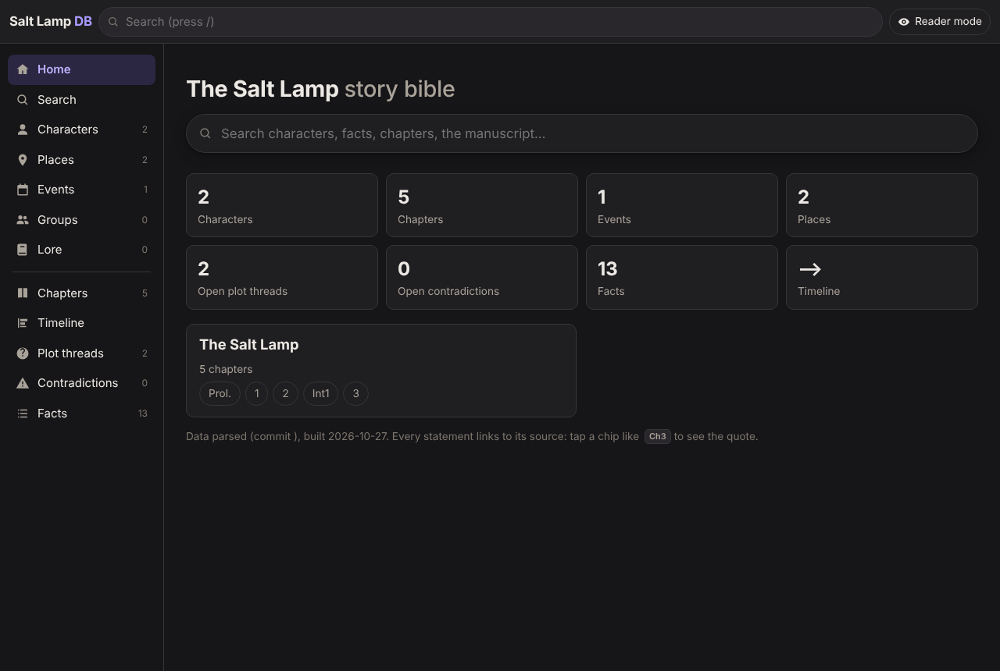
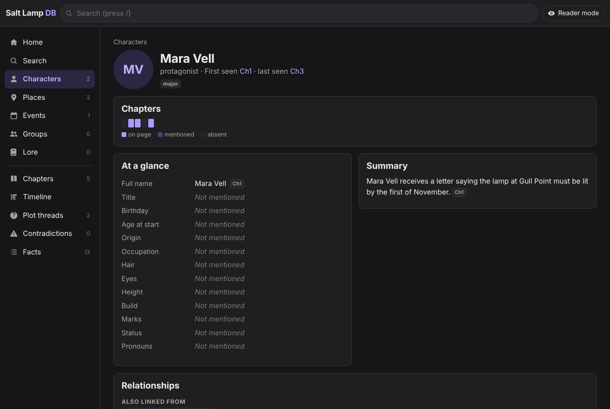
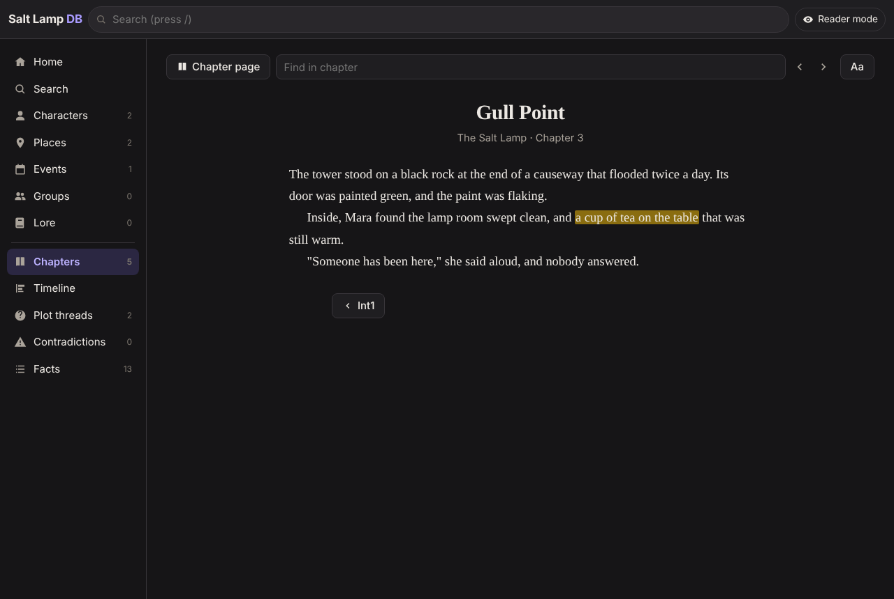
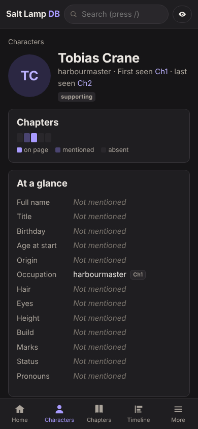

# Book DB Generator

Turn your manuscript into a private, searchable **story bible**: a web app for phone and PC that shows your characters, places, events, chapters, a timeline, plot threads and contradictions, with **every statement linked to the exact quote** it comes from.

You write. When you want the database updated, you upload the new version and ask Claude to **reparse**. Claude (through [Claude Code](https://claude.com/claude-code)) reads the changed chapters, extracts every concrete detail with a verbatim quote, re-checks its own work in a separate pass, and rebuilds the app. Nothing is guessed: if the books don't say it, the app shows *Not mentioned*. When two passages disagree, the app shows both and lists the disagreement. It never picks a side.

| | |
|---|---|
|  |  |
|  |  |

*Screenshots from a three-chapter demo story.*

## What you get

- **Characters**: an at-a-glance profile (blanks show as *Not mentioned*), a cited summary, and every detail by category: appearance, a chapter-by-chapter **wardrobe**, tastes, habits and mannerisms, backstory, personality, relationships, abilities, goals, secrets, **who knows what**, and **every lie**. Plus the chapters they appear in (on page or only mentioned) and their arc per book.
- **Places, events, groups and lore**, cross-linked: who was where, what happened there, causes and consequences, sub-events.
- **Chapters** with dates, point of view, summary and cast, and a **reader view** that opens any quote in context.
- **Timeline** of in-world dates.
- **Plot threads**: open mysteries, promises, setups, secrets and conflicts, traced through the chapters until the text resolves them.
- **Contradictions**: every disagreement between passages (or between the text and your planning sheet), with all sides quoted. You mark them *intended* or *not an issue*.
- **Reader-knowledge mode**: show only what a reader knows as of any chapter. Spoiler-free checks, or a safe view for beta readers.
- **Search** across everything, including the full manuscript.
- **Talk about your story**: type `/query` in Claude Code to ask questions, brainstorm or plan. Claude looks things up in the DB and your text, cites canon, labels ideas and plans as such, and changes nothing.
- Works with **series** (several books), **prologues, epilogues and interludes**, supplementary **posts**, an optional **planning sheet**, and manuscripts in other languages.
- **Private**: hosted free behind an emailed-code login on Cloudflare, or opened straight from your computer. Installable on your phone's home screen, and works offline.

## How it works

```
planning/          your plans and outlines. Never parsed: plans aren't canon
source/            you upload here: book1.docx or book1.md (+ optional sheet.csv, posts/)
   │
   │  node tools/extract.mjs  (plain script: normalizes the file, keeps italics and chapter headings)
   ▼
text/              book1.md: the readable mirror that quotes and diffs are based on
   │
   │  "reparse"  (Claude: reads the changed chapters, extracts facts with verbatim quotes,
   │              then a separate pass verifies every entry and sweeps for missed details)
   ▼
data/              JSON database: chapters, characters, places, events, threads, contradictions
   │
   │  node tools/build.mjs  (plain script, no AI: validates every quote, cross-links, bundles)
   ▼
app/               the web app (phone and PC), hosted privately or opened locally
media/             images you add by hand (picked up automatically by filename)
```

| Layer | Who writes it | What it holds |
|---|---|---|
| `source/`, `planning/` | You | Manuscripts, the optional sheet and posts; your plans. The AI never edits them unless you ask. |
| `text/` | Converter script | A normalized copy of each book. Quotes are checked against it, and its git diff shows what you changed. |
| `data/` | Claude | Facts extracted per chapter, plus sourced profiles, threads and contradictions. Your own `notes` fields are never overwritten. |
| `app/db.js`, `app/text.js` | Build script | Everything merged, cross-referenced and validated, plus the chapter text for the reader view. |

The scripts are plain Node.js with no dependencies to install. The build refuses any statement without a source and any quote it can't find word for word in that chapter, so the database can't drift from your text. A quote existing doesn't prove the statement is right, which is why every extraction gets a second, independent verification pass.

## Get started

Follow **[docs/SETUP.md](docs/SETUP.md)**. In short:

1. Make a **private** copy of this repository (**Use this template**, or import it).
2. Set your app's name and books in `config.json` (or ask Claude to).
3. Upload your manuscript (`.docx` or `.md`) to `source/`.
4. Open [Claude Code](https://claude.ai/code) on your repository and say **"Do the first parse."**
5. Host it privately with [docs/HOSTING.md](docs/HOSTING.md) (free), or open `app/index.html` from your computer.

You need a GitHub account (free), a Claude plan that includes Claude Code (Pro, Max or Team), and optionally a Cloudflare account (free) for hosting.

## Docs

- [docs/SETUP.md](docs/SETUP.md): step-by-step setup, first parse, day-to-day use, troubleshooting
- [docs/CONFIGURATION.md](docs/CONFIGURATION.md): every option in `config.json`, colours, icon
- [docs/HOSTING.md](docs/HOSTING.md): free private hosting on Cloudflare, and installing the app on your phone
- [docs/PROJECT.md](docs/PROJECT.md): your notes about your books, for the AI (conventions, sheet layout, decisions)
- [docs/DESIGN.md](docs/DESIGN.md): goals, architecture decisions, app features
- [docs/DATA_MODEL.md](docs/DATA_MODEL.md): file layout, IDs, citations, and the schema of every record type
- [docs/PARSING_GUIDE.md](docs/PARSING_GUIDE.md): the rules Claude follows when extracting facts
- [docs/UPDATE_WORKFLOW.md](docs/UPDATE_WORKFLOW.md): the first parse and the incremental reparse
- [CLAUDE.md](CLAUDE.md): standing instructions for AI sessions in this repository

## Privacy

Your manuscript stays in your private GitHub repository. The hosted app contains the chapter text (for the reader view), so it must be behind a login: [docs/HOSTING.md](docs/HOSTING.md) sets that up and has you test it. Parsing sends your text to Claude, under the terms of your Claude plan.

## Sharing this template

If you publish your own fork or variant of this template, mark it as a template so others can copy it with one click: on GitHub, open **Settings**, then under **General** tick **Template repository**. Keep your own books in a separate, private repository made from the template.

## License

Public domain, under [the Unlicense](LICENSE). Use, copy, modify, share or sell it for any purpose, with no need to give credit or keep any notice.
